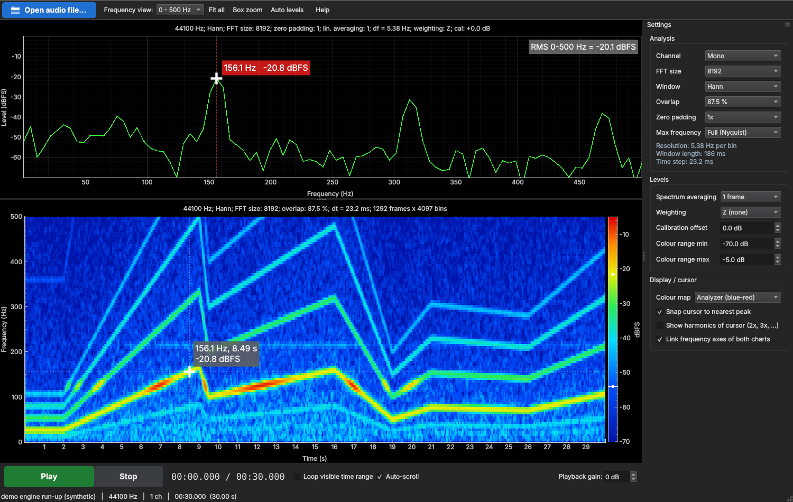

# Sound Analyzer

Desktop spectrogram + spectrum analyzer for audio files, built for automotive NVH work
(inspecting lows and mids). Load a recording, zoom/pan both charts on both axes, and read
exact frequency / level values from linked cursors. Play/pause with a moving playhead.



## Install & run

### Windows executable

Download and run the [standalone Windows executable](builds/SoundAnalyzer.exe). Python and
pip are not required.

### Run from Python

Python 3.10+ is recommended.

```bash
pip install -r requirements.txt
python sound_analyzer.py                 # then click "Open audio file...", or drag a file onto the window
python sound_analyzer.py recording.wav   # open a file directly
python sound_analyzer.py --demo          # synthetic engine run-up to try it out
```

For the Python install, Windows and macOS pip wheels include everything you need.
Linux: you may also need PortAudio for playback (`sudo apt install libportaudio2`).

Supported formats: WAV, FLAC, OGG/Opus, MP3, AIFF, W64/RF64, CAF (via libsndfile).
M4A/AAC aren't supported; convert those to WAV or FLAC first.

## Using it

**Charts**: the top chart is the spectrum (frequency vs level) and the bottom chart is the
spectrogram (time vs frequency, with level as colour).

**Cursor**
- Hover the spectrogram to see the spectrum at that moment in the top chart.
- Click the spectrogram to move the playhead there and pin the cursor frequency.
- Hover or click the spectrum to move or pin the cursor frequency.
- The cursor snaps to the nearest peak by default. You can turn this off in Settings.
- When you're not hovering, the spectrum follows the playhead. During playback it works
  as a live analyzer.

**Zoom / pan** (both charts)
| Action | Effect |
|---|---|
| Wheel | zoom both axes around the pointer |
| Wheel over an axis | zoom only that axis |
| Ctrl + wheel / Shift + wheel | zoom X only / Y only |
| Left-drag | pan (or draw a zoom box when **Box zoom** is on) |
| Right-drag | stretch X and Y independently |
| Right-click | view menu, including **Export** (PNG/SVG/CSV) |
| **Frequency view** dropdown | jump to 0–100 Hz, 0–200 Hz … 0–10 kHz |

The frequency axes of the two charts are linked, so zooming one zooms the other.
You can unlink them in Settings.

**Keys**: `Space` play/pause, `Home` go to start, `←/→` step one frame,
`Shift+←/→` step 1 s, `F` fit view, `Ctrl+O` open.

**Playback**: Play/Pause and Stop. You can loop the visible time range (handy for
listening to one event repeatedly) and boost quiet recordings with playback gain.
Gain only affects what you hear, not the analysis. For multichannel files, playback
follows the selected analysis channel.

## Settings

| Setting | Notes |
|---|---|
| FFT size | 1024 – 65536. Resolution = sample rate / FFT size (8192 @ 44.1 kHz ≈ 5.4 Hz) |
| Window | Hann (default), Hamming, Blackman, Blackman-Harris, Flat top (most accurate amplitude), Rectangular |
| Overlap | 0 – 93.75 %. Higher gives smoother time steps |
| Zero padding | 1× – 8×. Interpolates the spectrum for more precise peak readout |
| Max frequency | Discards content above this limit, which saves memory and gives finer time steps on long files |
| Spectrum averaging | Linear (power) average of N adjacent frames in the spectrum chart |
| Weighting | Z (flat), A, C |
| Calibration offset | Added to all levels. Enter your mic/recorder calibration to read dB SPL |
| Colour range | Drag the colour bar, type exact values, or press **Auto levels** (fits to the visible region) |

**Level reference**: 0 dBFS = a full-scale sine wave, read at its spectral peak.
The **RMS** box on the spectrum shows the level of the *visible frequency band* at the
cursor time. Zoom the spectrum to choose the band, e.g. 20–200 Hz for boom.

Long recordings: the app keeps at most ~40 M spectrogram cells (~160 MB) in memory.
On long files it widens the time step and shows the actual value in Settings. Lower
**Max frequency** to get finer time steps back.

Your settings are remembered between sessions.
